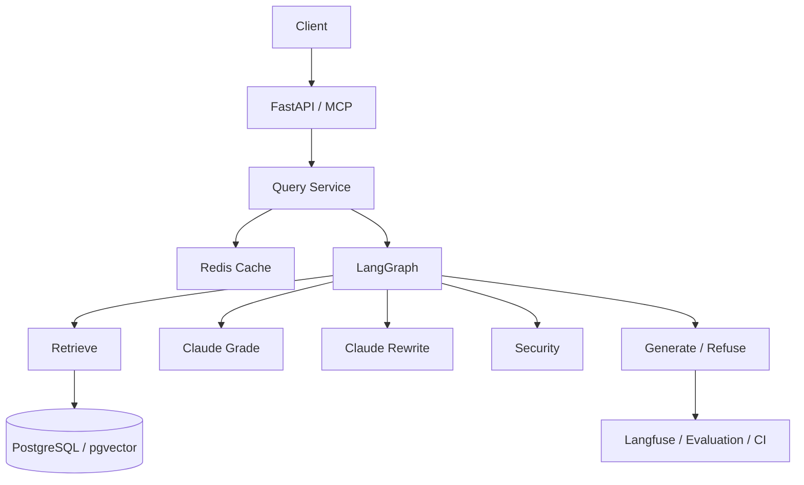

# DOCGUARD
**Secure Document Intelligence Agent**

*Security-first Corrective RAG that treats retrieved documents as untrusted data, quarantines unsafe context, and generates grounded cited answers or safely refuses.*


---

## The Problem

Enterprise LLM applications (like Retrieval-Augmented Generation or RAG) often blindly trust the documents they retrieve from their databases. This creates a massive security vulnerability: if a malicious actor injects a hidden prompt or leaked credential into a document (e.g., a PDF upload or wiki page), the LLM will read it, execute the malicious instructions, or expose sensitive data to unauthorized users.

## The Solution (DocGuard)

**DocGuard** is a defensive security boundary for RAG applications. Instead of trusting retrieved documents, DocGuard treats them as **untrusted data**. 

Before any document reaches the language model, DocGuard mathematically and programmatically scans it for prompt injections, PII (Personally Identifiable Information), and leaked secrets. Any malicious or unsafe document is completely **quarantined and excised** from the context. Finally, DocGuard enforces strict deterministic citation-ID validation to ensure the LLM only generates answers grounded in the verified, safe context.

---

## Architecture



---

## Why DocGuard?

**Traditional RAG:**
`retrieve → generate`

**DocGuard:**
`retrieve → relevance grading → corrective query rewriting → security scanning → quarantine → grounded generation → citation validation → safe refusal`

DocGuard establishes a strict security boundary, mathematically and programmatically ensuring that adversarial documents are detected and structurally excluded from the generation context before the final LLM invocation.

---

## Feature Showcase

### Corrective RAG
- **pgvector retrieval:** High-performance approximate nearest neighbor search.
- **Claude relevance grading:** Granular document-level relevance scoring.
- **Bounded query rewrite loop:** Re-retrieval based on Claude 3.5 Sonnet heuristics if initial context is poor.

### Adversarial Document Defense
- **Prompt injection detection:** Programmatic scanning for overriding instructions.
- **PII detection:** Scans for emails, phones, and credit card patterns.
- **Secret detection:** Catches leaked API keys, tokens, and private keys.
- **Quarantine isolation:** Malicious documents are excised entirely.

### Grounded Generation
- **Verified context only:** The generation model never sees unverified data.
- **Citation-ID validation:** Deterministic verification of reference IDs.
- **Refusal on unsupported context:** Silence over hallucination.

### Production-Oriented Infrastructure
- **FastAPI:** Fully typed asynchronous web gateway.
- **MCP:** Tool interoperability for Claude Desktop and Cursor.
- **Redis:** Sliding-window rate limiting and semantic caching.
- **Langfuse:** Span-level token and latency observability.
- **Docker:** Non-root, multi-stage reproducible runtime.
- **CI/CD:** Automated regression gates and evaluation pipelines.

---

## Security Flow

Documents in DocGuard are treated strictly as **DATA**, not instructions.

```text
Untrusted document
       ↓
    Retrieve
       ↓
     Grade
       ↓
 Security Scanner
       ↓
 ┌──────────────┐
 │              │
CLEAN         UNSAFE
 │              │
 ▼              ▼
Generate    Quarantine
                │
                └→ Never enters generation context
```

---

## Quick Start

```bash
git clone https://github.com/Vardxn/docguard.git
cd docguard

python3 -m venv .venv
source .venv/bin/activate
pip install -e ".[dev,mcp]"

cp .env.example .env

docker compose up -d --build
```
Then verify health:
```bash
curl http://localhost:8000/health
```

---

## API Showcase

All protected endpoints require authentication.
`Authorization: Bearer <YOUR_TOKEN>`

### `GET /health/ready`
Verifies database and cache connectivity.

### `POST /documents/ingest`
```json
{
  "content": "Project Alpha is launching in October.",
  "metadata": {"source": "engineering_wiki"}
}
```

### `POST /query`
```json
{
  "query": "When is Project Alpha launching?"
}
```
**Response:**
```json
{
  "answer": "Project Alpha is launching in October.",
  "citations": ["doc-123"],
  "refusal_reason": null
}
```

---

## MCP Showcase

DocGuard implements the Model Context Protocol (MCP) to expose internal tools.

**Tool:** `query_docguard`
**Description:** Interfaces directly with the LangGraph pipeline, maintaining identical retrieval, security, and generation behavior.
**Current Transport:** `stdio` (Initial implementation)

---

## Observability

DocGuard uses **Langfuse** for complete span-level observability.

**Trace Structure:**
```text
DocGuard Request
├── Retrieve
├── Grade
├── Rewrite
├── Security
└── Generate
```

**Intentional Omissions:**
To protect enterprise privacy, DocGuard intentionally does **NOT** log:
- API keys or Bearer tokens
- Raw PII
- Executable quarantine payloads

---

## Evaluation Scorecard

> [!WARNING]
> **DEVELOPMENT BENCHMARK DISCLAIMER**
> Benchmark results are based on the project's reproducible synthetic/development evaluation dataset (130 cases). They are intended for regression tracking and engineering validation, not as a claim of real-world enterprise performance.

| Metric | Result | Dataset | Notes |
|---|---|---|---|
| Precision@K | 0.0 | Synthetic | Mocked retrieval for CI isolation |
| Recall@K | 0.0 | Synthetic | Mocked retrieval for CI isolation |
| Hit@K | 0.0 | Synthetic | Mocked retrieval for CI isolation |
| Grader F1 | 0.67 | Synthetic | 30 cases |
| Rewrite Recovery | N/A | Synthetic | |
| Security Recall | 1.0 | Synthetic | 30 cases |
| Security FPR | 1.0 | Synthetic | 30 cases |
| Citation Validity | 1.0 | Synthetic | 20 cases |
| Correct Refusal Rate | 0.5 | Synthetic | 20 cases |
| Unsafe Answer Rate | 0.0 | Synthetic | 20 cases |
| P50 Latency | 0.87ms | Synthetic | Offline mock latency |
| P95 Latency | 2.3ms | Synthetic | Offline mock latency |

---

## Architecture Decisions

| Decision | Why |
|---|---|
| **LangGraph** | Stateful routing and bounded corrective looping. |
| **Direct SDKs** | Explicit provider control and fewer opaque abstractions. |
| **PostgreSQL + pgvector** | Transactional storage combined with vector retrieval. |
| **Redis** | Centralized caching and sliding-window rate limiting. |
| **FastAPI** | Strongly typed, asynchronous Python API layer. |
| **MCP** | Standardized agent and tool interoperability. |
| **Langfuse** | Precise token, cost, and span observability. |
| **Docker** | Reproducible, non-root runtime environments. |
| **GitHub Actions** | Automated validation and evaluation regression testing. |

---

## Known Limitations

- The benchmark dataset is currently synthetic/development-oriented.
- There is no claim of "zero hallucinations".
- There is no claim of "100% security" against all novel prompt injections.
- Cache invalidation is TTL-based.
- Rate limiting uses fixed-window increments.
- MCP transport is currently `stdio`-only.
- Production deployment outside of Docker Compose is not currently claimed.

---

## Project Structure

```text
src/docguard/
  ├── agent/       # LangGraph state machine & nodes
  ├── api/         # FastAPI gateway, auth & rate limiting
  ├── security/    # PII, secret, and injection detectors
  ├── storage/     # Redis semantic caching
  ├── services/    # Core orchestrator services
  ├── mcp/         # FastMCP Server implementation
  └── eval/        # Evaluation harness and metrics

tests/             # 112+ Unit, Integration, and Security tests
benchmarks/        # Frozen baseline metrics
scripts/           # Demos and synthetic data generation
.github/           # CI/CD regression workflows
```

---

## Portfolio Demo

You can interactively demonstrate DocGuard's entire feature set locally.

1. **Grounded answer**
2. **Corrective RAG rewrite**
3. **Adversarial document quarantine**
4. **Safe refusal**
5. **Rate limiting**
6. **MCP Invocation**
7. **Langfuse trace generation**

Run the following scripts against a live `docker-compose` instance:
```bash
python scripts/demo.py
python scripts/demo_mcp.py
```
*(Note: Requires valid live provider credentials in `.env`)*
